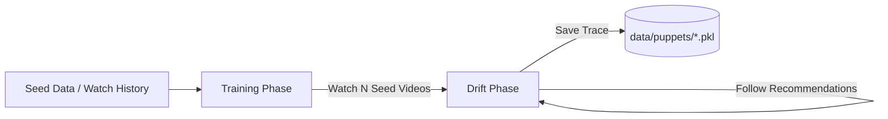

# YouTube Political Snowballer

This repo uses sock puppet auditing to navigate youtube's recommendation system from a seed list of video ID's. It is useful for collecting large datasets of political videos for analysis.

---

## Overview

Each sock puppet navigates through two core phases:

1. **Training Phase (`train`)**: The puppet watches a curated set of political seed videos matching a specific condition (`left`, `center`, `right`, or `anti-system`).
2. **Drifting / Snowballing Phase (`drift`)**: The puppet transitions to autonomous browsing by iteratively sampling and following recommended videos from watch pages. 

---

## Architecture & Workflow



- **Browser Automation**: Powered by [Patchright](https://github.com/Kaliiiiiiiiii-Vinyzu/patchright) (stealth Chromium) with persistent browser sessions and automatic cookie consent handling.
- **Concurreny**: Asynchronous multi-puppet execution managed via Python's `asyncio.TaskGroup`.
- **Data Capture**: Records watched videos, recommendation lists, watch times, topics, and error logs per interaction.

---

## Getting Started

### 1. Prerequisites

- Python 3.11+
- Google Chrome

### 2. Installation

Clone the repository and install dependencies:

```bash
git clone https://github.com/gustavidun/youtube-political-snowballer.git
cd youtube-political-snowballer

python -m venv .venv
source .venv/bin/activate

pip install -r requirements.txt
python -m patchright install chrome --with-deps
```

### 3. Environment Configuration

Create a `.env` file in the project root:

```env
API_KEY='["YOUR_YOUTUBE_DATA_API_KEY"]'
```

---

## Usage

### Batch Run

Run concurrent sock-puppet sessions using `src/batch_run.py`:

```bash
cd src
python -m batch_run --n 45 --train 100 --drift 200 --headless
```

#### CLI Arguments

| Argument | Type | Default | Description |
| :--- | :--- | :--- | :--- |
| `--n` | `int` | `45` | Total number of sock puppets to launch concurrently |
| `--train` | `int` | `100` | Number of seed videos watched during the training phase |
| `--drift` | `int` | `200` | Number of recommendation hops during the drift phase |
| `--headless` | `bool` | `True` | Run Chrome in headless mode (`True`/`False`) |
| `--debug` | `flag` | `False` | Enable verbose debug logging |

### Docker Execution

A `Dockerfile` is provided for running containerized puppets with virtual displays:

```bash
docker build -t yt-snowballer .
docker run --rm -v $(pwd)/data:/app/data yt-snowballer
```

---

## Output Data

All run artifacts are persisted in the `data/` directory:

- `data/puppets/<puppet_id>.pkl`: Serialized pandas DataFrame with interaction-level records (watched video, recommended video IDs, watch duration, topics, errors).
- `data/logs/<puppet_id>.log`: Per-puppet execution logs.
- `data/session/<puppet_id>/`: Persistent Chromium profile and browser state.